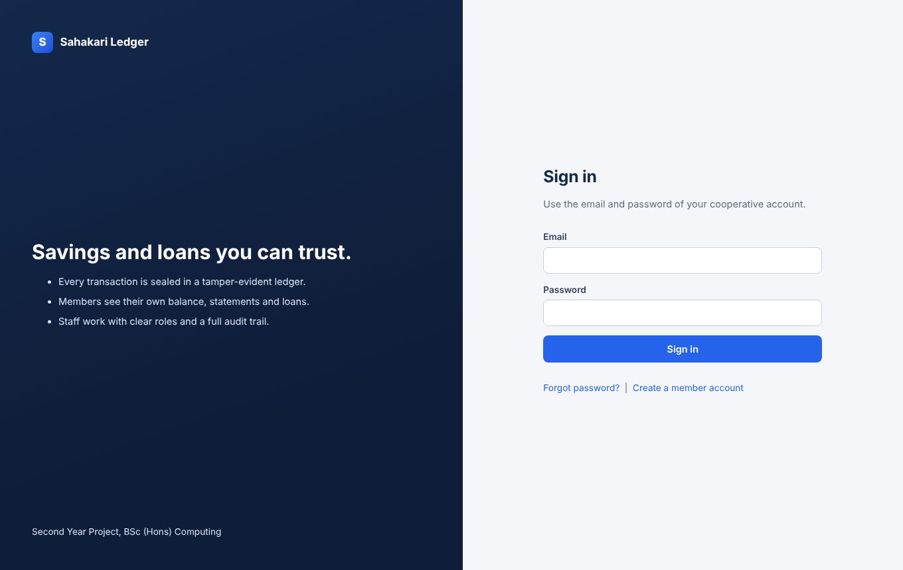
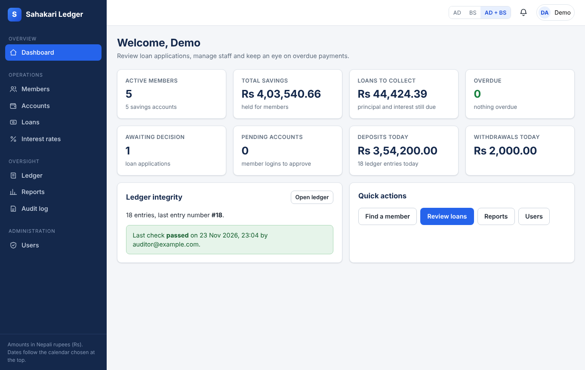
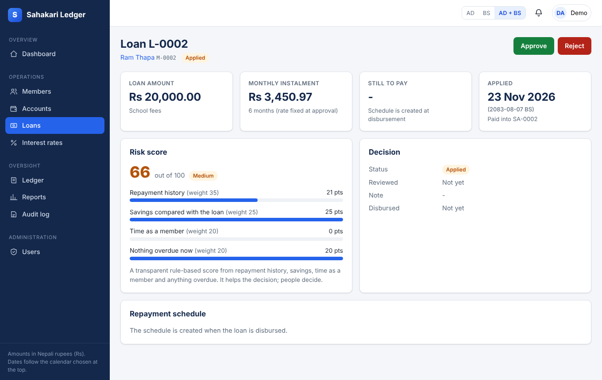
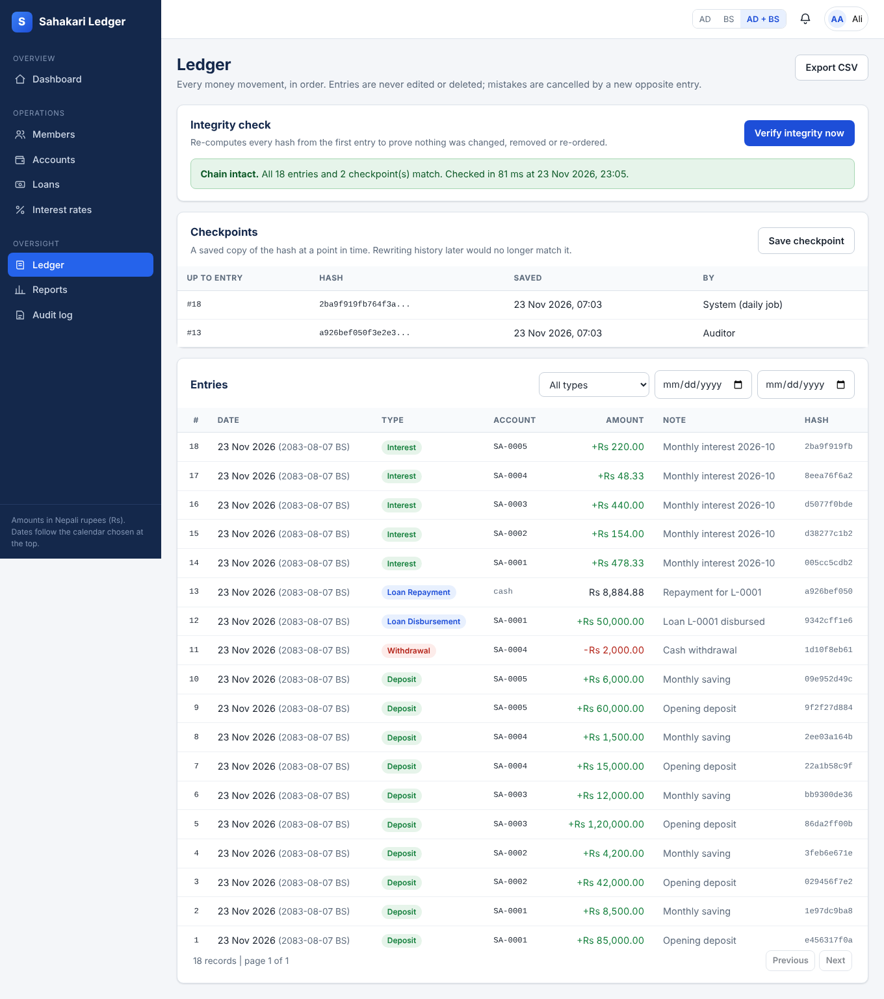

# Sahakari Ledger

A web system for savings and credit cooperatives (sahakari) in Nepal. It manages members, savings accounts and loans,
and records **every money movement in a hash-chained ledger**, so that any later change to old records can be detected and traced.

> BSc (Hons) Computing, Second Year Project, Itahari International College.

| Sign in | Admin dashboard |
|---|---|
|  |  |
| **Loan with risk score** | **Ledger and integrity check** |
|  |  |

## Features

**Members and savings**
- Member registration with nominee and address, search and filters, suspend or reactivate
- Savings accounts, deposits and withdrawals with balance checks, statements as screen or **PDF**
- Monthly savings interest posted automatically, once per account per month

**Loans**
- Members apply online. The system shows an estimated instalment and enforces limits (up to 5 times savings)
- Transparent **rule-based risk score** (repayment history, savings cover, time as member, overdue items)
- Approve or reject with a reason, disburse into the savings account, automatic **reducing-balance EMI schedule**
- Cash repayments clear the oldest instalments first, partial payments supported, overdue tracking and defaulter list

**Tamper-evident ledger**
- Append-only entries, each sealed with an HMAC-SHA256 hash that includes the hash of the previous entry
- **Integrity check** re-computes the whole chain and reports the first problem; daily **checkpoints** catch even a full history rewrite
- Mistakes are corrected by a reversing entry, never by editing

**Security and control**
- Four roles (admin, teller, member, auditor) with permission-based access control enforced on the server
- Member self-registration with staff approval, short-lived access tokens, rotating refresh tokens, lockout after repeated failures
- Separation of duties: tellers handle money, admins approve loans, auditors can only read and verify
- Audit log of sensitive actions, CSV exports and PDF reports, in-app notifications and due-date reminders
- Dates shown in AD, **Bikram Sambat (BS)**, or both

## Tech stack

| Part | Tools |
|---|---|
| Frontend | React 18, Vite, React Router, hand-written CSS design system |
| Backend | Node.js 20, Express 4, Mongoose, JWT, bcrypt, express-validator, helmet, PDFKit |
| Database | MongoDB |
| Tests | Node test runner and Supertest (59 tests) |
| Delivery | GitHub Actions CI, Dockerfile, docker-compose for local MongoDB |

## Quick start

You need **Node.js 20+** and **MongoDB** (local, Docker, or a free MongoDB Atlas cluster).

```bash
# 1. Database (optional, if you do not have MongoDB yet)
docker compose up -d

# 2. Backend
cd server
cp .env.example .env     # then set JWT_ACCESS_SECRET and LEDGER_HMAC_SECRET (see below)
npm install
npm run seed:demo        # admin, interest rates, sample members, accounts, loans (use "npm run seed" for just the admin)
npm run dev              # API on http://localhost:5000

# 3. Frontend (second terminal)
cd client
npm install
npm run dev              # app on http://localhost:5173
```

Generate each secret (32+ random characters) with:

```bash
node -e "console.log(require('crypto').randomBytes(48).toString('hex'))"
```

**Demo logins** (password for all: `Demo#Ledger2026`, set by `npm run seed:demo`)

| Email | Role |
|---|---|
| `demoadmin@example.com` | Admin |
| `teller@example.com` | Teller |
| `auditor@example.com` | Auditor |
| `sita@example.com`, `ram@example.com` | Members |

The seeded `admin@example.com` (password from `.env`) must change its password at first sign-in.

**Single-service build:** run `npm run build` in `client/`, then start the server. If `client/dist` exists, the API serves the app too.

## Documentation

| File | What it explains |
|---|---|
| [docs/ARCHITECTURE.md](docs/ARCHITECTURE.md) | How the system works: ledger and hash chain, loan maths, risk score, jobs, security model, limitations |
| [docs/API.md](docs/API.md) | Every endpoint with the permission it needs |
| [docs/DEMO.md](docs/DEMO.md) | A 10-minute demo script for the defense, including the tamper demo |
| [docs/DEPLOYMENT.md](docs/DEPLOYMENT.md) | Deploying with MongoDB Atlas and a hosting service |
| [docs/Auth_Design.docx](docs/Auth_Design.docx) | Authentication and authorization design |
| `docs/diagrams/` | Gantt chart, WBS, use cases, ERD, sequence diagrams, wireframes |

## Tests

```bash
cd server
npm test                                                        # 35 unit and API tests, no database needed
E2E_MONGO_URI=mongodb://127.0.0.1:27017/sahakari_test npm test  # all 59, including 24 end-to-end tests
```

The end-to-end tests cover the full journey: registration and approval, deposits (including 20 at the same time),
loans from application to closing, overdue handling, reports, and **four kinds of tampering** (edited amount,
rewritten history, deleted entry, edited balance). **They wipe the database they connect to, so use a test database.**

## Project structure

```
server/src/   config, constants (roles), models, middleware, services (ledger, risk, jobs, pdf), controllers, routes, scripts
server/tests/ unit, API and end-to-end tests
client/src/   api, auth, components, pages, lib (formatting, BS dates)
docs/         architecture, API, demo, deployment, diagrams, weekly logs
```

## Working rules

- Commit at least once a week with a clear message such as `feat(loans): add repayment allocation`.
- Work on a branch (`feature/<name>`) and merge into `main` when it works. Keep `main` runnable.
- Add the supervisors as collaborators: **Settings, Collaborators, Add people**.
- Never commit `.env` files, secrets or real member data.
